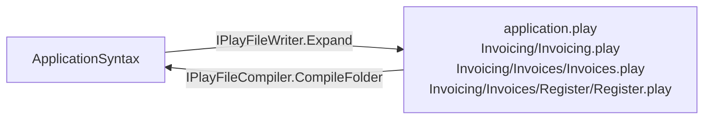

# Folders

Cratis Screenplay compiles a folder of `.play` files as one application, so you can split a large model without duplicating its shared declarations. Use folders when finding a slice or reviewing a change becomes difficult in one file.

Modules contain features, and features contain slices. Mirroring that structure in folders gives each slice its own source file while concepts, events and policies still resolve across the assembled application. The file writer can also expand an existing application into this layout:



Folder compilation includes every `.play` file beneath the root. In the layout above, each slice file restates its module and feature. If you want a root document to choose the application's files, or want slice files without those repeated headers, use [imports](imports.md). Imports specify both file membership and placement within a module or feature.

## Order on the board

When viewing a folder application, both boards compile **every** `.play` file in the folder in alphabetical file-path order. When VS Code opens an importing document with no `application.play` above it, it instead compiles that document and what it imports. An application root's [import order](imports.md#order-on-the-event-model-board) supplies presentation ranks only. Unimported files remain visible after ranked siblings, in their previous relative order; merge diagnostics and event ownership do not change.

VS Code recognizes `application.play` as the folder root; the MCP App can also find a single importing root with another name when the folder has no `application.play`. Imports expand depth-first where they are written; declarations within a file keep text order, and glob matches stay alphabetical. Explicit container declarations in the root or an enclosing container's own named file take precedence over restating slice files. With no importing root—including an import-less `application.play` written by `IPlayFileWriter.Expand`—the board keeps path order.

Use explicit imports in a composite file when the story needs a particular sequence. Expanding a file into folders does not by itself preserve its board order. Ordering affects presentation, not executable model bytes or identities.

Folder compilation also checks the merged application's [event flow on the timeline](imports.md#timeline-diagnostics). It uses the sole root, an importing folder-root `application.play`, or the unique importing root, in that order; without an ordering root it skips the check. `PLAY0516` identifies a slice using an event declared to its right, and `PLAY0517` identifies a mutually dependent group. Both are information diagnostics and do not fail `--warnaserror`.

## Compile a folder as one application

`CompileFolder` discovers every `.play` file beneath a folder, merges them into the one application they describe, and resolves the whole:

```csharp
using Cratis.Screenplay.Files;

var compilation = new PlayFileCompiler().CompileFolder(root);

if (compilation.Result.Success)
{
    var application = compilation.Result.Value!;
}
```

The compiler merges the files before resolving references. An event declared in one file can be produced in another, and a concept declared once at the root is available to every slice. An `authorize` reference can likewise find a policy in another file of the application.

Compare that with [`CompileIn`](tool.md#use-the-compiler-as-a-library), which compiles every file as a document in its own right. Given a folder where `Register.play` declares `InvoiceRegistered` and `Submit.play` produces it, `CompileIn` reports:

```text
Submit.play(5,9): warning PLAY0165: Unknown type 'InvoiceId' on 'invoiceId' of command 'Submit' - declare it with 'concept InvoiceId : <Primitive>' or 'type InvoiceId'
Submit.play(6,9): warning PLAY0167: Unknown policy 'CanManageInvoice' - declare it with 'policy CanManageInvoice'
Submit.play(7,9): warning PLAY0166: Unknown event 'InvoiceRegistered' - declare it with 'event InvoiceRegistered'
```

Those declarations are missing from `Submit.play` in isolation, not from the assembled application. `CompileFolder` resolves them across the files. Use `CompileIn` only when the files are independent documents that happen to share a folder.

### Compiling documents in memory

An editor or generator can compile a folder without writing temporary files. Pass the
same relative paths and source texts that would be stored on disk:

```csharp
using Cratis.Screenplay.Files;

IPlayFileCompiler compiler = new PlayFileCompiler();
PlayFileContent[] documents =
[
    new("application.play", "import \"concepts/*.play\""),
    new("concepts/InvoiceId.play", "concept InvoiceId : Uuid")
];
var folder = compiler.CompileFolder(documents);
var application = compiler.CompileApplication("application.play", documents);
```

`CompileFolder` merges all supplied documents, regardless of their input order.
`CompileApplication` compiles only the entry document and the documents its imports reach.
Both use the disk APIs' import, merge and cross-file validation rules; imports can only
resolve to supplied documents. Both also accept a visitor, which runs only on success.

Paths must be relative `.play` paths within the document set. Backslashes and `.` segments
are normalized to portable `/` paths; rooted paths, paths escaping the set, duplicate
normalized paths, and null source texts throw `ArgumentException`. A null document set
throws `ArgumentNullException`. An empty folder succeeds with no sources or diagnostics;
an entry path not in the set throws `ArgumentException`.

`Sources` retains each document's text and its normalized document-set path in
`File.Path`, without inventing a disk location. `File.RelativePath` and diagnostic paths
are relative to the document-set root for a folder, or to the entry document's folder
for an application, matching the corresponding disk API.

### Declared dependencies across files

[Module and feature dependencies](slices.md#declared-dependencies) accumulate on the same owner in ordinal file-path order, regardless of import presentation order. Repeated resolved targets are kept once with `PLAY0555` on each repeat; unresolved repeats compare by text. Target resolution uses the merged inventory, so a target may be declared in another file. Layout expansion writes dependencies only in the owner's own file and strips them from restated ancestor headers, like `description`.

### Documentation across files

Module and feature `documentation` follows first-wins merge order, just like descriptions: identical copies are accepted, and a different copy warns with `PLAY0559` while retaining the first text. Put reasoning in the owning container file. Layout expansion keeps it there and strips it from restated ancestor headers. See [Descriptions and documentation](slices.md#descriptions-and-documentation).

### Diagnostics know which file they came from

A diagnostic in a multi-file model needs to identify its source document. Every `SourceLocation` in a folder compilation therefore carries the relative path of the file it came from:

```csharp
foreach (var diagnostic in compilation.Result.Diagnostics)
{
    Console.WriteLine($"{diagnostic.Location.Path}({diagnostic.Location.Line},{diagnostic.Location.Column}): {diagnostic.Message}");
}
```

A location carries a path exactly when the compiler was told one. `ScreenplayCompiler.Compile` is never told one, so `Path` stays `null` there and nothing about compiling a single document changed. The compilation also hands back the source text of every file it read, in `Sources`, so a diagnostic can be rendered with its offending line by [the formatter](tool.md#verify-your-files):

```csharp
var sources = compilation.Sources.ToDictionary(source => source.File.RelativePath, source => source.Source);
var formatter = new DiagnosticFormatter();

foreach (var diagnostic in compilation.Result.Diagnostics)
{
    var file = diagnostic.Location.Path!;
    Console.WriteLine(formatter.Format(file, diagnostic, sources[file], useColors: true));
}
```

### Drive a visitor over the folder

To turn the compiled syntax tree into your own representation, pass a [visitor](visitors.md). The folder and file entry points both accept one:

```csharp
var compiler = new PlayFileCompiler();

var fromFolder = compiler.CompileFolder(root, new MyApplicationVisitor());
var fromFile = compiler.CompileFile(path, new MyApplicationVisitor());
```

Both return an `ApplicationCompilation<T>` carrying the visitor's result and the diagnostics. The visitor sees the merged application - one tree, whatever it was spread across - and runs only when the compilation had no errors.

### The CLI does this too

`screenplay <folder>` verifies every `.play` file in the folder as one application. `screenplay <file>` verifies the file and any documents its file imports reach:

```bash
screenplay path/to/screenplays          # the folder, as one application
screenplay path/to/invoicing.play       # that file, on its own
```

The second command checks only `invoicing.play` when it has no file imports. For an importing root, see [Compile an application](imports.md#compile-an-application).

## Propose revision-safe workspace changes

When an editor changes an existing model, the source bytes matter as well as the model's meaning. Keep the exact
documents in a `ScreenplayWorkspace` rather than reconstructing them from the merged syntax tree. The workspace
accepts strict UTF-8 documents, portable paths, stable document identities and an identity catalog, which records
the durable identities assigned to model elements. It derives semantic compilation without rewriting the source:

```csharp
using Cratis.Screenplay.Semantics;
using Cratis.Screenplay.Workspaces;

var catalog = SemanticIdentityCatalog.Empty(ApplicationIdentity.Create("Invoicing"));
var document = WorkspaceDocument.Create(
    "application",
    PortablePlayPath.Parse("application.play"),
    sourceBytes);
var workspace = ScreenplayWorkspace.Create("Invoicing", [document], catalog);
```

When the source compiles, workspace creation materializes the current document, semantic, and event-contract
identities into the returned catalog. When it does not compile, the workspace still retains every exact authored
byte and exposes the failed `Compilation`; opening imperfect source never destroys it.

### Use identities owned by another system

If your authoring system already assigns durable keys, use those keys to create Screenplay identities rather than
constructing semantic addresses for hashing or formatting canonical identity strings. Create semantic identities
from the artifact kind and stable key, and scope event-contract identities to the stable application identity:

```csharp
using System.Text;
using Cratis.Screenplay.Semantics;
using Cratis.Screenplay.Workspaces;

var applicationIdentity = ApplicationIdentity.Create("studio-application-42");
var document = WorkspaceDocument.Create(
    "registration",
    PortablePlayPath.Parse("Projects/Registration.play"),
    Encoding.UTF8.GetBytes(
        """
        module Projects
          feature Registration
            slice StateChange RegisterProject
              command RegisterProject
              event ProjectRegistered
        """));
var sliceAddress = SemanticAddress.ForSlice(
    applicationIdentity,
    "Projects",
    "Registration",
    "RegisterProject");
var commandAddress = SemanticAddress.ForCommand(sliceAddress, "RegisterProject");
var eventAddress = SemanticAddress.ForEventContract(sliceAddress, "ProjectRegistered");
var commandIdentity = SemanticId.Create(SemanticKind.Command, "studio-command-node-42");
var eventSemanticIdentity = SemanticId.Create(SemanticKind.EventContract, "studio-event-node-42");
var eventContractIdentity = EventContractId.Create(applicationIdentity, "studio-event-contract-42");
var catalog = SemanticIdentityCatalog.Create(
    applicationIdentity,
    [],
    [
        new(commandAddress, commandIdentity, SemanticIdentityOrigin.Persisted),
        new(eventAddress, eventSemanticIdentity, SemanticIdentityOrigin.Persisted)
    ],
    [
        new(
            eventAddress,
            eventContractIdentity,
            EventContractRevision.Initial,
            SemanticIdentityOrigin.Persisted)
    ]);
var workspace = ScreenplayWorkspace.Create(
    applicationIdentity,
    "Project portfolio",
    [document],
    catalog);
```

`SemanticId.Create(SemanticKind, string)` separates every semantic kind. `EventContractId.Create(ApplicationIdentity,
string)` also separates applications. Both external-key factories normalize keys to Unicode NFC and reject empty
keys, malformed Unicode, control characters, and path-like values. Treat their canonical results as opaque.

The explicit `ScreenplayWorkspace.Create` overload keeps `ApplicationIdentity` independent from the friendly ESM
application name. A display-name change therefore changes the semantic and workspace revisions but not the catalog
revision or assigned identities. Persisted assignments also survive document moves. Declaration renames preserve
them only through the transaction's explicit `SemanticIdentityRename` and `EventContractIdentityRename` mappings;
Screenplay never guesses continuity from similar names or locations. The original three-argument overload and the
address/name-derived identity factories remain the compatibility path for existing source.

Propose changes against the workspace and identity-catalog revisions you read. These checks prevent a proposal
based on an older source or catalog state from being accepted:

```csharp
var result = workspace.Propose(new WorkspaceTransactionRequest
{
    ExpectedRevision = workspace.Revision,
    ExpectedCatalogRevision = workspace.IdentityCatalog.Revision,
    Operations =
    [
        new ReplaceWorkspaceDocument
        {
            Document = document.Id,
            Bytes = updatedSourceBytes
        }
    ]
});

if (result.Success)
{
    var candidate = result.Workspace!;
    foreach (var entry in result.WritePlan!.Entries)
    {
        Console.WriteLine($"{entry.Kind}: {entry.Before?.Path} -> {entry.After?.Path}");
    }
}
```

A stale revision, portable path collision, duplicate owner, malformed operation, invalid identity migration, or
failed compile rejects the complete proposal. The original workspace is untouched. The write plan contains exact
before/after documents but performs no file-system operation; the consuming host decides whether and where to save it.
Document key renames preserve `DocumentId` explicitly. Removing declarations requires explicit semantic and event
retirements, so deleting source cannot silently erase durable identity continuity.

Whole-document changes, single-file-to-folder restructuring and the field-level patches below use this same
transaction contract. Review the returned write plan before your host saves the candidate.

### Patch a slice description by its stable semantic identity

Most edits a host makes are whole-document replacements. One field is different: a slice's single-line quoted
`description` is small, frequent to edit, and addressed more naturally by the slice's stable `SemanticId` than
by document and byte range. `UpdateSliceDescription` is a `WorkspaceOperation` like any other - it goes through
the exact same `Operations` array, the same revision gates, and the same parse/merge/bind/identity pipeline -
it is not a second preview/apply method:

```csharp
var slice = workspace.Compilation.Value!.Model.Application.Modules.Single().Features.Single().Slices.Single();
var result = workspace.Propose(new WorkspaceTransactionRequest
{
    ExpectedRevision = workspace.Revision,
    ExpectedCatalogRevision = workspace.IdentityCatalog.Revision,
    Operations =
    [
        new UpdateSliceDescription
        {
            SemanticId = slice.Id,
            ExpectedCurrentDescription = "Registers a new project",
            NewDescription = "Registers a brand new project"
        }
    ]
});
```

A successful proposal changes only the description's literal body bytes - every other byte of the owning
document, and every other document in the workspace, is untouched - and produces exactly one `Replaced` write
entry, going through the same `WritePlan` shape as a whole-document edit. The operation is admitted only for an
existing **single-line quoted** slice description; it fails typed rather than falling back to raw text editing:

- `SemanticIdNotFound` - the semantic identity does not exist in the workspace's identity catalog.
- `UnsupportedSemanticField` - the identity exists but does not address a slice (a module, feature, or command
  identity), or the slice has no single-line quoted description to patch (missing entirely, or written as a
  fenced multi-line block).
- `SemanticFieldValueDrift` - `ExpectedCurrentDescription` does not match the decoded current text exactly.
- `MultiOwnerSemanticEdit` - another operation in the same transaction, semantic or whole-document, already
  claims the owning document; a transaction may touch one document once regardless of how many of its
  operations reach it.

The stale-revision and stale-catalog-revision gates run before any operation is even inspected, exactly as they
do for whole-document operations. This is the first semantic patch; broadening it to other fields or to
multi-line descriptions is future work, not something this operation attempts today.

### Change one produced-event mapping source

To change which command property supplies an existing event property, use `UpdateProducedEventMappingSource`.
You address declarations, not text occurrences: even when a comment or another command repeats the same mapping,
only the selected right-hand source changes. Start with a compiled workspace containing one explicit mapping such
as `name = name`, and a compatible `displayName` property on that command:

```csharp
var slice = workspace.Compilation.Value!.Model.Application.Modules.Single().Features.Single().Slices.Single();
var command = slice.Commands.Single(value => value.Name == "RegisterProject");
var producedEvent = slice.Events.Single(value => value.Name == "ProjectRegistered");
var result = workspace.Propose(new WorkspaceTransactionRequest
{
    ExpectedRevision = workspace.Revision,
    ExpectedCatalogRevision = workspace.IdentityCatalog.Revision,
    Operations =
    [
        new UpdateProducedEventMappingSource
        {
            Command = command.Id,
            ProducedEvent = producedEvent.Id,
            TargetProperty = producedEvent.Properties.Single(value => value.Name == "name").Id,
            ExpectedSourceCommandProperty = command.Properties.Single(value => value.Name == "name").Id,
            NewSourceCommandProperty = command.Properties.Single(value => value.Name == "displayName").Id
        }
    ]
});
```

`ProducedEvent` is the event declaration's **`SemanticId`**, not its persisted **`EventContractId`**. Both source
properties must belong to the addressed command; the target must belong to the addressed event. Their resolved
value types and collection shapes must match the target, and an optional source cannot fill a required target.
Exactly one production of that event must exist on the command, and it must be unconditional. The mapping must
already be explicit and use a direct property source. Literals, computed or nested expressions, inferred mappings,
and repeated productions are not editable through this operation.

Submit this operation **alone**, without document operations, other semantic patches, or identity migrations.
Stale workspace and catalog checks still run first. Unknown identities reject with `SemanticIdNotFound`, wrong
owners, incompatible types, unsupported grammar, ambiguous source ownership, or unproven equivalence with
`UnsupportedSemanticField`, and a changed expected source with `SemanticFieldValueDrift`. Mixed operations or
identity migrations reject with `InvalidOperation`; an unbindable workspace rejects with `CompilationFailed`.
Every rejection returns neither a candidate workspace nor a write plan.

A successful proposal preserves the UTF-8 BOM, comments, whitespace, line endings, Unicode, and every byte outside
the parser-owned source range. It passes the normal compile/migrate/recompile pipeline, compares the complete
candidate semantics against an independent one-mapping graph edit, and proves canonical print/recompile semantic
equivalence without printing over authored source. Identities, destinations, conditions, and specification
expectations remain unchanged. Selecting the current source is an admitted no-op with no write entries.

This changes real declarative behavior, not code attachments, and Screenplay does **not** rewrite specification
expectations to make them pass. A `then` value that the new source can no longer produce from the stated `when`
values is a compile error (`PLAY0285`), so such a proposal rejects with `CompilationFailed` and its diagnostics.
Run your semantic specifications on an accepted candidate for everything the static check cannot decide.
This bounded operation does not complete general declarative patching or provide a file-system publisher; use the
[write plan](#propose-revision-safe-workspace-changes) to review exact changes before your host publishes them.

## Write an application out as a folder

The inverse lives next to it. `Expand` turns an application into the files of a folder structure without touching the file system, and `WriteTo` puts them on disk:

```csharp
using Cratis.Screenplay.Files;

var writer = new PlayFileWriter();

foreach (var file in writer.Expand(application))
{
    Console.WriteLine(file.RelativePath);   // and file.Content
}

writer.WriteTo(application, root);
```

Use `Expand` when you need to inspect or package the files before writing them. `WriteTo` creates the folders it needs and overwrites the files it names, but leaves other files beneath the root alone. A previously removed slice can therefore leave a stale `.play` file that the next folder compilation will include. Write generated layouts to a fresh destination, or use a workspace write plan to review changes to an existing model.

### What lands where

Every level of the language gets a folder, and the file inside a folder carries that level's own content:

```text
application.play                                    domain, imports, concepts, types,
                                                    policies, personas, authentication, onboarding, identity, seed
Invoicing/
  Invoicing.play                                    module Invoicing - description and templates
  Invoices/
    Invoices.play                                   feature Invoices - description
    Register/
      Register.play                                 slice StateChange Register
    Submit/
      Submit.play                                   slice StateChange Submit
    Archiving/
      Archiving.play                                nested feature Archiving - description
      Archive/
        Archive.play                                slice StateChange Archive
```

| File | Holds |
|---|---|
| `application.play` | Everything that belongs to the application as a whole rather than to any one module: `domain`, `import`, `concept`, `type`, `policy`, `persona`, `authentication`, `onboarding`, `identity` and `seed`. There is one, always, at the root. |
| `<Module>/<Module>.play` | The module's own `description`, `authorize`, `screen template`, `dialog template`, `form`, and `contribute` declarations - not its features. |
| `<Module>/…/<Feature>/<Feature>.play` | The feature's own `description`, `authorize` and `contribute` declarations - not its slices or sub features. |
| `<Module>/…/<Feature>/<Slice>/<Slice>.play` | One slice, whole. |

Every one of those is a complete `.play` document. A slice file restates the module and feature it belongs to, because that is what the language needs in order to place a slice:

```screenplay
module Invoicing
  feature Invoices
    slice StateChange Register
      event InvoiceRegistered
        invoiceId InvoiceId
```

Nothing is written twice. The restated `module Invoicing` in a slice file carries no description, authorization, templates, forms, contributions, behavior attachments, or module-header comments - those live in the module's own file. Restated features likewise carry no description, authorization, contributions, behavior attachments or header comments, including when they are ancestors of a nested feature. Comments inside a slice stay in its slice file.

## How the files become one application

The merge combines declarations into one application. Repeated module and feature headers identify the same container; they do not create separate copies. Other declarations follow these rules:

| Declaration | What the merge does |
|---|---|
| `module`, `feature` | **Combined by name.** Every file naming `module Invoicing` is talking about the same module. This is what lets a slice live in its own file and still belong to its feature. Header comments from every file survive, including identical text in different files. The owner file's trailing header comment stays inline; printing places the other header comments above the combined header in file-path order, then source order within each file. |
| `slice`, `screen template`, `dialog template`, `form` | Accumulated. A second file declaring one that already exists in the same owner is an error. |
| `contribute` on a module or feature | Accumulated under that owner. Several contributions may target the same outlet. |
| `authorize` on a module or feature | Distinct gates in different files accumulate with AND in file-path order; no file can silently override another's gate. An identical gate repeated in another file is kept once with a `PLAY0394` warning. Expansion writes the gate only in its owner's file and strips it from restated headers. Command and query authorization is additionally AND-composed with every enclosing feature and module gate. |
| `on` on a module or feature | Accumulated under that owner, in file-path order. Inline behaviors are additive, so distinct `on` blocks from different files all run. A block identical to one another file already attaches is ignored with a `PLAY0340` warning, so it runs once. Expansion writes them only in the owner's own file. |
| `uses` on a module or feature | Accumulated under that owner, in file-path order. Attaching the same behavior with the same arguments from a second file is ignored with a `PLAY0340` warning, so it runs once; the same behavior with different arguments is two distinct attachments, and both are kept. Expansion writes them only in the owner's own file. |
| `concept`, `type`, `policy`, `persona` | Accumulated. Concepts and types share one namespace, so a `type` cannot take a `concept`'s name. A second file declaring one that already exists is an error. |
| `domain`, `authentication`, `onboarding`, `identity` | At most one for the whole folder. A second file declaring one is an error. |
| Unquoted contract `import` | Merged and de-duplicated. A contract import declared anywhere applies to the whole application, exactly as it does within a single document. Quoted file imports select and place documents before the merge. |
| `seed` | Accumulated, the same way multiple `seed` blocks accumulate within one document. |
| `description` on a module or feature | The first one given wins. A second, different one is a warning - only the file that owns the folder is expected to describe it. |

A duplicate is reported **only when the same name is declared in more than one file**, and it always names both ends - the file the name was already claimed in, and the location of the file that tried to claim it again:

```text
second.play(1,1): error PLAY0173: Duplicate declaration of 'InvoiceId' - already declared in 'first.play'
second.play(3,5): error PLAY0173: Duplicate slice 'Register' in feature 'Invoices' - already declared in 'first.play'
second.play(1,1): error PLAY0172: The folder already declares a domain in 'first.play' - a folder compiles to one application, which can have at most one
```

Duplicates *within* one file are left to the single document compiler, which already has its own rules for them. Compiling one document behaves exactly as it always has. Ownership is attached to the file declaring a member, never to a module or feature header restated to place a child; descriptions are not declarations and keep their warning behavior. A workspace transaction that encounters a cross-file declaration error returns `ConflictingOwner`, with `Path` for the second claimant and `OtherPath` for the first; it offers no write plan. Other parse, binding and validation failures remain `CompilationFailed`. An external disk edit since proposal is rejected before the first write; reopen the workspace rather than applying a stale plan.

### Why `import` still means what it meant

An unquoted contract import names something from outside the application, such as another bounded context's event contract. It does not load another `.play` file. Declarations in files compiled together are already in scope, so importing one of your own declarations reports `PLAY0290` and has no effect. References and consistency checks still resolve to the local declaration. Use a [quoted file import](imports.md#import-files) when you need to include another document.

```text
application.play(2,1): warning PLAY0290: Import 'Catalog.ItemView' names 'ItemView', which this application declares - the import has no effect
```

## Round-tripping

`PlayFileWriter.Expand` uses the same folder-layout projection as workspace layout changes. `WriteTo` still creates directories and overwrites files directly for existing callers; unlike a workspace write plan it has no prior revision, hashes or managed-file inventory to check. `PlayFileCompiler.CompileFolder` shares the folder merge used by workspace semantic compilation, but retains its syntax result, source strings, caller-supplied compiler/file discovery, and diagnostics even on invalid input. It cannot open an exact-byte workspace without changing legacy path/encoding admission and failure behavior. Use workspace proposals and the destination's drift checks when a save must reject stale files.

Writing a folder and compiling it back preserves the application's declarations, subject to the ordering rules below. The Invoicing round-trip specification checks structural equivalence after accounting for path order, then checks that expanding the result produces the same file paths and contents. A separate fixture covers module forms, behavior attachments on modules and features, and contributions on modules, features and nested features, including when the owner's file sorts after its descendants.

**Declaration order depends on the layout.** With the import-less `PlayFileWriter.Expand` layout, modules, features and slices come back sorted by name rather than in the order they were authored. MCP `expand-layout` writes imports that preserve sibling order and a child's position among its parent's other members, so collapsing that layout retains interleaved contributions and templates too. Everything within a slice - including the order of its events, commands, constraints and specifications - comes back in authored order, because it never left its file. Without import-position evidence, members of a module or feature that span different files have no shared source order; canonical printing uses kind order for those members. Leading and trailing comments follow the declarations they annotate when the layout changes. Blank lines are canonical rather than copied from the original source.

## When a folder is the wrong fit

Keep a small model in one file while it remains easy to navigate. A document generated end to end may also be simpler to write with [the printer](printing.md) than to split into folders.

Give unrelated applications separate roots: `CompileFolder` merges everything beneath its root and cannot infer that the files describe different applications. Also avoid sibling declaration names that differ only in casing. Expansion rejects paths a file system cannot distinguish with `AmbiguousPlayFilePath` rather than silently losing a declaration.

## See also

- [AST authoring API](ast-authoring.md) - create and edit typed nodes atomically across original documents.
- [MCP authoring](mcp/authoring-tools.md) - review and apply AST changes or choose a new file layout from an MCP client.
- [Compiler and CLI](tool.md) - compiling, diagnostics, and the command line tool.
- [Printing and generating](printing.md) - the whole application as one document.
- [Modules, features and slices](slices.md) - the structure the folders mirror.
