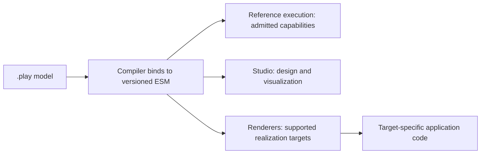

import { CardGrid, LinkCard } from '@astrojs/starlight/components';

Cratis Screenplay is a declarative modeling language for describing events, commands, read models (queryable views of recorded facts), screens, and specifications in one portable `.play` model. People and AI agents read the same model, so a discussion about what a feature should do can refer to the declarations and examples that describe it.

Start with the behavior: what someone asks the system to do, which facts that produces, and what someone needs to see afterward. Screenplay keeps those connections visible without requiring you to follow them through controllers, storage code, and UI wiring.

## Start here

[Write your first `.play` model](/screenplay/getting-started/) to describe borrowing a library book and try editor highlighting, completions, and live diagnostics. You finish with a model to review, not a running application. If you are deciding whether Screenplay fits your work, read the rationale first; the other guides help you explore an existing model or go deeper into the language.

<CardGrid>
  <LinkCard title="Write your first model" href="/screenplay/getting-started/" description="Author a small feature and explore editor diagnostics." />
  <LinkCard title="Why Screenplay" href="/screenplay/why-screenplay/" description="Understand the synchronization work it addresses and when to keep a slice hand-written." />
  <LinkCard title="See your event model" href="/screenplay/see-your-event-model/" description="Explore the board surfaces and supported ways to generate a model from code." />
  <LinkCard title="Language overview" href="/screenplay/overview/" description="Read the design principles, file structure, and language reference map." />
  <LinkCard title="Acme Commerce: a walkthrough" href="/screenplay/acme-commerce-walkthrough/" description="Follow a five-domain shop through public events, anti-corruption, screens, and Studio." />
</CardGrid>

## What belongs in the model?

A slice groups the declarations for one behavior. For employee registration, that could mean the registration command, the event recording that an employee registered, a read model for looking the employee up, and specifications of accepted and rejected requests. A screen describes how someone uses that behavior. You can keep the model in one file or split it across files as it grows.

Selected implementation points can carry inline code or file references when declarations are not enough. Those attachments do not define the portable meaning of the language. [Why Screenplay](/screenplay/why-screenplay/) explains when to model a slice and when to keep it hand-written.

Use the reference for the part you are working on:

- [Modules, features, and slices](/screenplay/slices/) organize behavior into typed slices aligned with Event Modeling.
- [Concepts](/screenplay/concepts/) declare value types and their compliance attributes once, so usages inherit the classification. This does not make an application automatically compliant.
- [Commands and events](/screenplay/commands/) describe intent, validation, authorization, and the facts produced.
- [Projections and queries](/screenplay/projections/) turn events into read models using the embedded Projection Declaration Language.
- [Screens](/screenplay/screens/) describe UI at three abstraction levels, from intent to templates with inline React.
- [Reactions and captures](/screenplay/reactions/) describe event-driven automations; captures turn external data into events.

## From model to consumers

The compiler turns the `.play` declarations into an executable semantic model (ESM): a versioned description of what the model means. Cratis Studio and target renderers consume that description rather than define separate meanings for it. Where Cratis Chronicle supplies execution semantics, the ESM preserves that behavior using portable names. The [semantic authority decision](https://github.com/Cratis/Screenplay/blob/main/decisions/0001-chronicle-runtime-semantic-authority.md) explains the boundary.

Before choosing a consumer, check which versions and capabilities it admits. A construct can be valid Screenplay without being executable by every target. A consumer must refuse behavior it cannot preserve, not silently skip it.

To check scenarios without a target application, use Screenplay's [reference execution](/screenplay/specifications/#reference-execution). It runs admitted capabilities in memory without starting Arc, Chronicle, a database, or a network service. Passing those checks does not prove that a target application can execute every construct.

For how [Cratis Arc](/arc/) and [Cratis Chronicle](/chronicle/) fit into the wider platform, read [Why developers choose Cratis](/why-cratis/).

## See a model run

Give a supported model to [Cratis Stage](/stage/), issue a command, then query the state it changes through its API or Scene screens. Stage is a disposable sandbox, not a production host: its in-memory state does not survive a container restart. Check admission diagnostics and bind published ports to `127.0.0.1`.

<LinkCard title="Run a Screenplay with Stage" href="/stage/docker/" description="Follow the sandbox walkthrough, including setup and a model to explore." />

## Go deeper

- [Sub-languages and inline code](/screenplay/sub-languages/): PDL and CDL are built-in grammars; `csharp`, `java`, `typescript`, `react`, `html`, and `sql` inline language tags are bounded realization attachments, not a promise of execution support.
- [The grammar](/screenplay/grammar/): the full EBNF definition of the language.
- [Glossary](/screenplay/glossary/): module, feature, slice, construct, sub-language, Stage, and Studio.
- [Frequently asked questions](/screenplay/faq/): indentation, bounded C#/React escape hatches, and the relationship to Arc and Chronicle.
