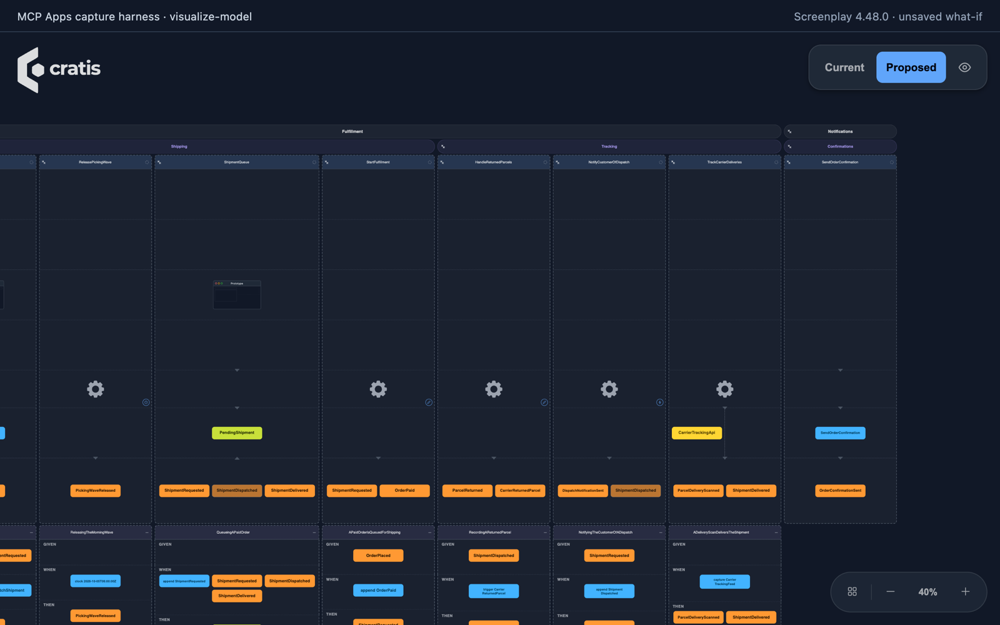

The [Cratis Screenplay MCP server](reference.md) draws an event model board inside
a supporting client so you can inspect the application or compare a proposed
change before applying it. Viewing the board never writes files. Your client must render
[MCP Apps](https://modelcontextprotocol.io/extensions/apps/overview), the protocol
extension for interactive views.

Use **Cratis.Screenplay.Tool 4.47.0 or later**, or **CLI versions that bundle
Screenplay 4.47.0 or later**. CLI hosting alone does not guarantee MCP Apps support.
See [installation](install.md) and [See your event model](../see-your-event-model.md)
for the same board in other places.



*Captured in a minimal MCP Apps test host (a local capture harness), not a
commercial chat host. The capture uses a single-file Commerce adaptation and an
unsaved what-if sketch.*

## Which clients show the board

The server offers `visualize-model` only when the client advertises the MCP Apps
extension (`io.modelcontextprotocol/ui`) as it connects. Other clients receive the
usual Screenplay tools without `visualize-model`; they can still
[inspect the model through text prompts](explore.md).

| Client | Draws the board |
| --- | --- |
| Claude Desktop | Yes |
| GitHub Copilot in VS Code | Yes |
| Claude Code | No, it is a terminal client |
| Codex | Not listed by the MCP Apps documentation as a host that draws views |

The [MCP Apps documentation](https://modelcontextprotocol.io/extensions/apps/overview)
keeps the current list of hosts. In a client that does not draw the board, use the
[VS Code extension](../vscode.md) to see a model, and keep using
[Explore a model](explore.md) in the terminal.

The board follows the host's light or dark theme, and changes with it while it is
on screen. It is dark when the host says nothing about its theme.

## Show the model on disk

```text
Show me the application as an event model board.
```

The assistant calls `visualize-model` without arguments. The board shows every
`.play` document under the server root, compiled as one application. The model
receives a short summary, such as how many slices, events, reactions and errors the board
shows. The documents themselves go only to the board.

<a id="spacing-and-text-size"></a>

The board has the Cratis logo in its upper left and its toolbar in its upper
right. *View* sets the detail level, whether properties are shown and whether
connections are drawn as arrows or lines. Where the host allows it, the toolbar
also draws the board again from disk and switches to fullscreen.

When the host lets a view call the server, the board checks disk every couple of
seconds and redraws after a file changes. This includes changes applied by the
assistant and edits you make by hand. You can keep it fullscreen while prompting.
A proposal stays visible until the files change; then the board shows the current
application. The refresh button redraws at once, or reports why it cannot.

If the host does not allow server calls from a view, the board cannot follow files
or offer that refresh action. Ask the assistant to show the board again to see the
model as it is now.

## Dependency map

Choose **Map** beside **Board** to inspect module and feature dependencies.
The map follows **Current** or **Proposed**, including what-if sketches. Modules
are columns in suggested producer-first order, features sit inside them, and
imported bounded contexts appear on the right. Arrows run from consumer to producer.

Choose edges between **Modules** or **Features**. The initial filters show
**uses facts from**, **reacts to**, and **decides from**; enable the other kinds
when needed. Edge labels count slice pairs. Select an edge to see the references
under each slice pair, with their kind, name and source location. Tab moves into
the drawing; arrow keys move between nodes and edges, Enter selects, and Escape clears.
Choose **Board** to return to the timeline. The map does not change the model or
highlight the board, and inferred dependencies do not prove executable readiness.

[Timeline findings](../imports.md#timeline-diagnostics) appear in the consumer slice header's information badge.

### Highlight dependencies on the board

Select a slice, feature or module header to trace its connections. You can click
it, or focus it and press Enter or Space. The board marks slices in that scope as
**selected**, the slices they depend on directly or indirectly as **dependency**,
and the slices that depend on them as **dependant**. Everything else is dimmed.
Each mark has an outline, a header marker and a text announcement, so color is not
the only way to read it.

Arcs above the board connect the marked slices. Thicker, dashed arcs cross feature
or module boundaries. Board highlighting always uses **uses facts from**,
**reacts to** and **decides from**, regardless of which kinds you check on the map.

Select the same header again to clear the highlight. It also clears when an edit removes the selected scope. The Current and Proposed boards each highlight their own dependencies. With nothing selected the board is drawn as usual. Selecting on the board is separate from the map: map selections do not highlight the board.

If the board cannot read or draw the model, **Board** and **Map** stay in the
toolbar. The Board view says why, and the Map stays available when the dependencies
were compiled. A failure in one view leaves the other in place. If compiling gives no
map, the Map view says it is unavailable. A selection stays when the view refreshes, as long as the
item still exists, and switching between **Current** and **Proposed** clears it.

## See what a proposal would change

Ask for a change, and ask to see it before it is applied:

```text
Add a ReturnBook slice to the Lending module that produces BookReturned. Propose
it, then show me the board for that proposal so I can see what it adds.
```

After an authoring call returns a `proposalId`, the assistant calls `visualize-model`
with it:

```json
{ "proposalId": "<proposalId>" }
```

The board opens on *Proposed*, the application as the proposal would leave it.
Switch to *Current* in the toolbar to compare it with the model on disk. Shared
elements keep their positions, making the differences easier to follow. The
summary lists the modules, features, slices, commands, events, read models, screens and reactions
the proposal adds and removes. Nothing is written: review and `apply` the proposal
as described in [Edit a model](edit.md#review-and-apply).

### Read the markers

The board marks what the proposal changes, so you do not have to compare the two
views by eye. Each marked module, feature, slice, command, event, external event and
read model carries a badge with an icon and a word: **Added**, **Changed** or **Removed**.
Screen readers announce the same text, such as "Added command: ReturnBook", so
the markers do not rely on color.

- **Proposed** marks what the proposal adds and changes.
- **Current** marks what the proposal removes. A removed element is not part of the
  proposed application, so it is only drawn, with a **Removed** badge, on *Current*.
- An element is **Changed** when its own content differs, such as the fields of a
  command or event. Its parent slice, feature and module are not marked for it.
  Reordering, collapsing and status changes are not changes.
- Some things the board draws have no marker of their own: queries, screens and their
  prototypes, specifications, the automation trigger, and the persona lanes. A change in
  one of them marks the element that holds it as **Changed**: the slice for a query,
  screen, specification or trigger, and the first module of the lanes for a persona.
  A slice that adds a screen is therefore **Changed**, not **Added** on the screen.

The toolbar says how much each view marks, for example **Proposed · 3 added,
1 changed** and **Current · 2 removed**. A view with nothing to mark keeps its plain
name.

The board opens scrolled to the first marked element in board order, and scrolls
there again each time you switch between *Current* and *Proposed*, so a change in a
later module is not off-screen. Without a proposal or sketch nothing is marked and
the board opens as before.

## Sketch a what-if

To see how a piece of functionality could look before shaping it into a proposal,
ask for a sketch:

```text
Without changing anything, sketch what a Reservations feature could look like next
to the existing Lending module, and show it on the board. Do not propose it yet.
```

The assistant passes whole `.play` documents as a `sketch`, with paths relative
to the model root. Multi-file sketches require Screenplay 4.59.1 or later, or a
CLI that bundles it; older versions such as 4.48.0 have sketch-path failures.
For a model whose complete source is `application.play`, this example replaces
that document for the view only:

```json
{
  "sketch": [
    { "path": "application.play", "source": "module Orders\n  feature Returns\n    slice StateChange RegisterReturn\n      command RegisterReturn\n        produces ReturnRegistered\n      event ReturnRegistered\n" }
  ]
}
```

Each document replaces the one at its path, or is added when there is none. The
sketch is drawn over the documents on disk exactly as a proposal is, with the same
*Current* and *Proposed* switch, the same summary and the same
[markers](#read-the-markers). It is never validated as a
proposal, never kept, and never written. A sketch that does not compile is drawn
as far as it can be read, with the number of errors shown on the board. Pass
either `proposalId` or `sketch`, not both.

Ask for the board again after each change to the sketch or the model: every call
draws a new board, from the model as it is at that moment.

## Compare with the VS Code extension

| | MCP board | VS Code extension |
| --- | --- | --- |
| Opens from | A prompt in the conversation | A `.play` file |
| Follows your edits | Polls disk when the host allows server calls; otherwise redraws on request | Redraws as you type |
| Shows a proposal or sketch | Yes | No |
| Needs the MCP server | Yes | No |

Use the extension while you write and the MCP board to inspect an assistant's
proposed change. Before applying it, [review the exact changes and diagnostics](edit.md#review-and-apply)
as well as the board.
