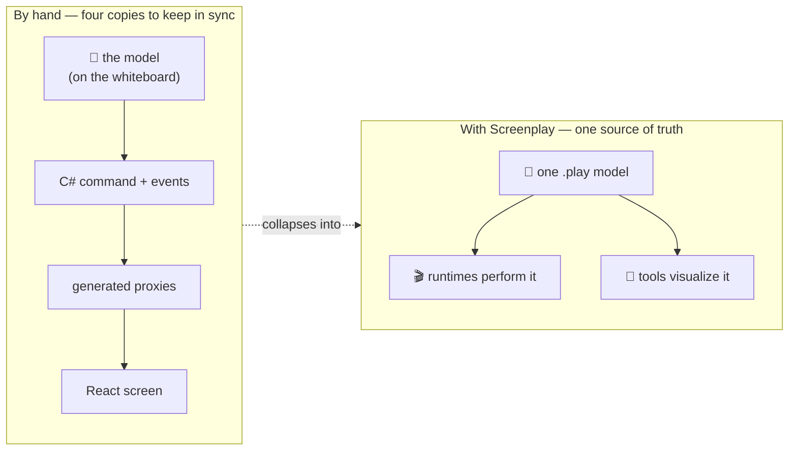

You already know what the feature is before you write a line of it. On the whiteboard there is a command, the events it produces, a read model those events project into, and a screen that shows the read model. The design is done. What remains is the part nobody enjoys: writing that same design out several more times, in several different places, and keeping every copy in step for the rest of the project's life.

## The friction: one model, written four times

A single "register an invoice" feature, built by hand, is spread across four artifacts that all describe the *same* thing:

- the **C# command** and its validation and authorization,
- the **events** it appends,
- the **projection and read model** that turn those events into queryable state,
- the **React screen** that renders it — through generated proxies that have to be regenerated whenever the backend shifts.

Types, generated proxies, and tests can catch many mismatches, but they do not by themselves keep the business design in one place. Rename an event field and you still need to coordinate its consumers. The model you reasoned about is spread across implementation artifacts.

Screenplay is an **optional model-first path** through the Cratis Platform. You can use [Arc](/arc/) or [Chronicle](/chronicle/) directly without adopting it, Stage, or Studio. Choose Screenplay when keeping the intended behavior explicit is worth maintaining a model; keep handwritten slices when they already express the design clearly.

## The relief: describe it once

A Screenplay `.play` model puts that intent together. This excerpt shows the command-and-event part of an invoicing slice; concepts and its authorization policy are declared elsewhere:

```screenplay
slice StateChange RegisterInvoice
  command RegisterInvoice
    invoiceId     InvoiceId identifier
    invoiceNumber InvoiceNumber
    authorize CanManageInvoice
    validate
      invoiceNumber matches "^INV-[0-9]{6}$"  message "Must look like INV-000000"
    produces InvoiceRegistered
      for invoiceId
      invoiceNumber = invoiceNumber
      registeredAt  = $context.occurred

  event InvoiceRegistered
    invoiceNumber InvoiceNumber
    registeredAt  DateTime
```

The command, its rules, and the fact it records sit together in the order you reasoned about them. `for invoiceId` routes the fact to the invoice's event source; the payload contains business data rather than a duplicate routing identifier. Screenplay now owns a versioned portable semantic foundation, and the compiler and downstream products are being connected to it capability by capability. Stage, Studio, and generated applications may not redefine that meaning or silently ignore a capability they cannot preserve.



## What makes it hold together

Three design choices keep the model readable and its intent explicit — they are covered in depth in the [language overview](overview.md):

- **Slices group behavior.** Commands, facts, and views sit in typed slices aligned with Event Modeling's vocabulary. Shared concepts and policies can sit outside slices; the structure follows the model rather than implementation layers.
- **Concepts carry data classification.** A value type declares `pii` or `sensitive` once, and usages inherit it. Those declarations keep classification visible; they do not by themselves establish legal compliance.
- **Declarative first, with bounded escape hatches.** The business meaning stays declarative. Selected implementation points can carry constrained inline code or a `file` reference without turning code into the semantic authority.

## When a hand-written slice is the better fit

Screenplay is not always the right tool, and pretending otherwise would waste your time:

- **Your system is not naturally command- and fact-oriented.** Screenplay is grounded in Event Modeling, event sourcing, commands, views, and vertical slices. It should not be forced onto a problem that has no useful expression in those terms.
- **Almost every construct needs custom logic.** If most of the behavior would live in opaque code attachments, a declarative wrapper may add ceremony rather than clarity. Write that slice by hand.
- **You need behavior the portable model cannot yet express.** Do not hide that gap behind a large code block or assume every runtime behaves the same way. Keep the implementation explicit and contribute evidence for the smallest missing semantic capability.

## What the first result proves

Start by checking a command's business rules with the in-memory reference evaluator, not by generating a whole application. A passing specification shows that the supported declarative behavior matches its stated expectation. It does not append to Chronicle, run attached code, or prove a renderer conforms.

If you need a live application, evaluate the intended consumer and its admitted ESM version separately. The [interoperability reference](interoperability.md) explains that handoff.

Convinced it fits? [Write and test your first `.play` file →](./getting-started.md)
