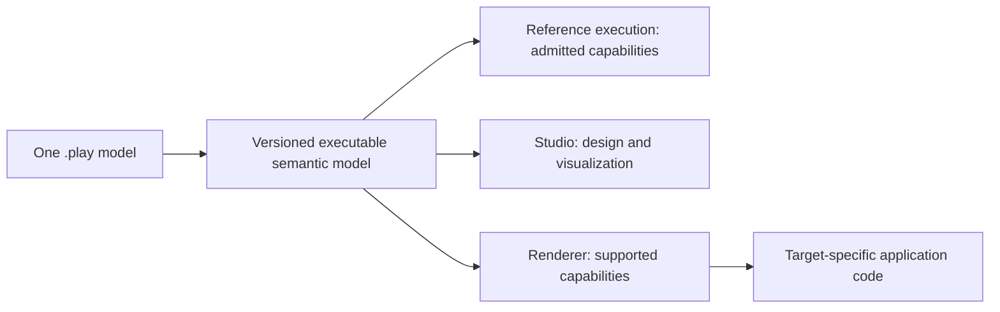

Cratis Screenplay is a declarative language that keeps a feature's events, commands, read models (queryable views of recorded facts), screens, and specifications in one readable `.play` model for people and AI agents. Use it when a business change means reconciling several descriptions of the same behavior across contracts, projections, APIs, and UI wiring.

A design discussion might connect a command to the event it produces, then to a read model and the screen that shows it. Implementing that design spreads those relationships across several layers. Screenplay lets you review them together, while keeping purpose-built code where declarations are not enough.

<a id="the-friction-one-model-written-four-times"></a>

## Where does synchronization work come from?

Consider invoice registration. A hand-written implementation connects a C# command and its validation and authorization to the events it appends. A projection turns those events into a read model. A React screen reads that state through generated client proxies.

Renaming an event field can mean changing projection mappings too. If the change reaches a client-facing contract, you may also need to regenerate proxies and update screen bindings. Compiler checks and tests can catch mismatches, but someone still has to carry the change through the affected artifacts. That coordination is the work Screenplay addresses.

<a id="the-relief-describe-it-once"></a>

## How does Screenplay keep behavior together?

This slice describes invoice registration: the input, who may request it, the invoice-number rule, and the event produced when it succeeds. The concept types and authorization policy are declared elsewhere in the model.

```screenplay title="RegisterInvoice.play"
slice StateChange RegisterInvoice
  command RegisterInvoice
    invoiceId     InvoiceId
    invoiceNumber InvoiceNumber
    authorize CanManageInvoice
    validate
      invoiceNumber matches "^INV-[0-9]{6}$"  message "Must look like INV-000000"
    produces InvoiceRegistered
      invoiceId     = invoiceId
      invoiceNumber = invoiceNumber
      registeredAt  = $context.occurred

  event InvoiceRegistered
    invoiceId     InvoiceId
    invoiceNumber InvoiceNumber
    registeredAt  DateTime
```

You can review the rule beside the event mapping instead of finding each part in a separate layer. The model can also hold the read models, screens, and specifications that complete the feature.

The compiler binds those declarations to an executable semantic model (ESM), a versioned description of their meaning. Where Cratis Chronicle supplies runtime behavior, the ESM follows that behavior using portable names. Cratis Studio and target renderers consume this meaning; they must reject capabilities they cannot preserve rather than silently reinterpret or ignore them.



To check a scenario without installing a runtime, use the [reference execution path](specifications.md#reference-execution). It runs admitted capabilities in memory without starting Arc, Chronicle, a database, or a network service. Its projection semantics still follow Chronicle. Passing those checks does not establish that a generated application supports the same model; check the consumer's capabilities separately.

## See a model run

For an interactive check, follow the [Cratis Stage sandbox walkthrough](/stage/docker/). Issue a command, query the changed state, and use the model's Scene screens. Stage runs supported behavior as a disposable sandbox, not a production host; its in-memory state does not survive a container restart. Check admission diagnostics and bind published ports to `127.0.0.1`.

## What makes it hold together

Typed slices organize behavior using Event Modeling's vocabulary rather than technical layers. A model can span several files without losing that structure.

Concepts give repeated values a shared type and classification. Declare `pii` for personal data or `secret` for operational secrets on a concept, and its usages inherit the classification. This saves repeated declarations; it does not make the application automatically compliant.

Where a declaration cannot express the needed logic, selected implementation points accept constrained inline code or a `file` reference. These attachments carry target logic, not a second definition of portable semantics. The [language overview](overview.md) explains these design choices and links to their references.

## When a hand-written slice is the better fit

Keep a slice hand-written when code expresses its behavior more directly. If almost every declaration needs inline C#, the wrapper may add more work than it removes. The same applies when the problem has no useful expression in Screenplay's command-, event-, and view-oriented model.

A missing semantic capability is also a reason to keep the implementation explicit. A large code block does not fill that gap portably, and one runtime's behavior does not establish another's. Record the smallest missing capability and the evidence needed to define it before moving that behavior into the model.

To try the approach on a small feature, [write your first `.play` file](./getting-started.md).
